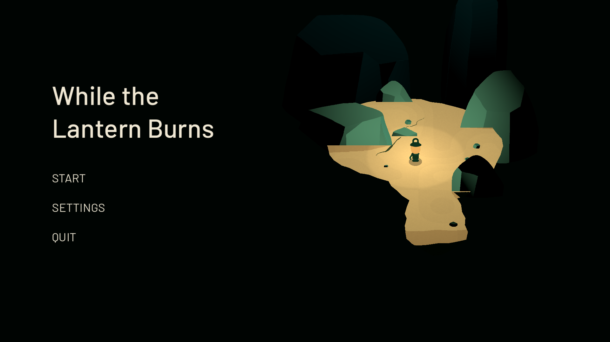
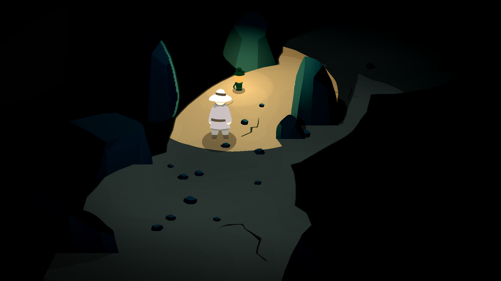
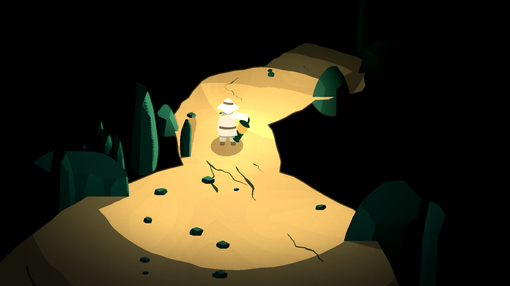
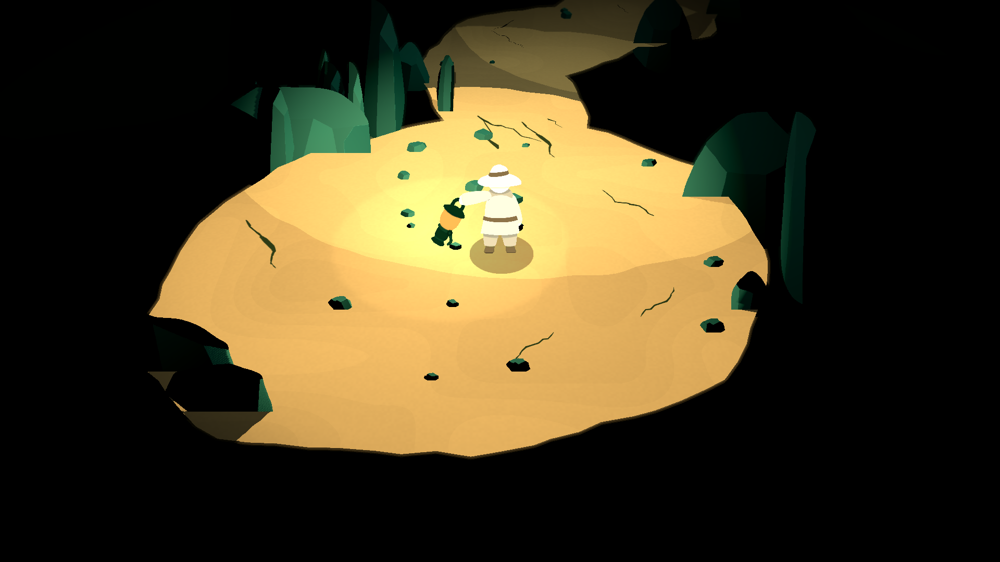
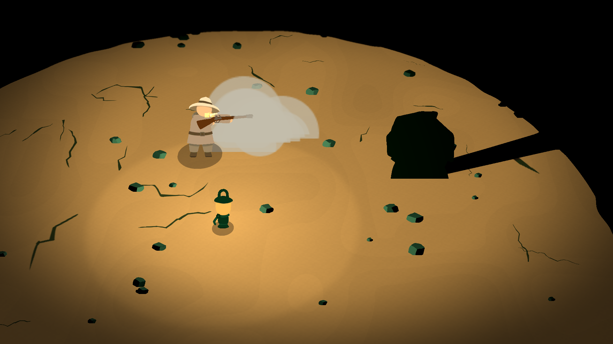
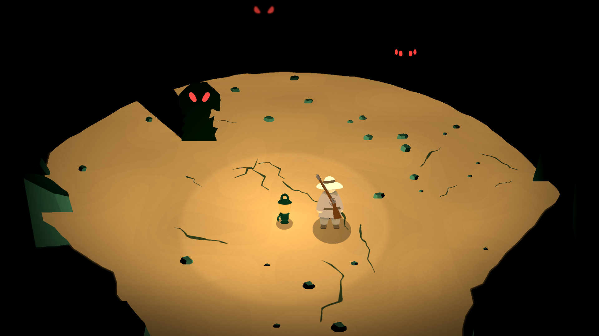
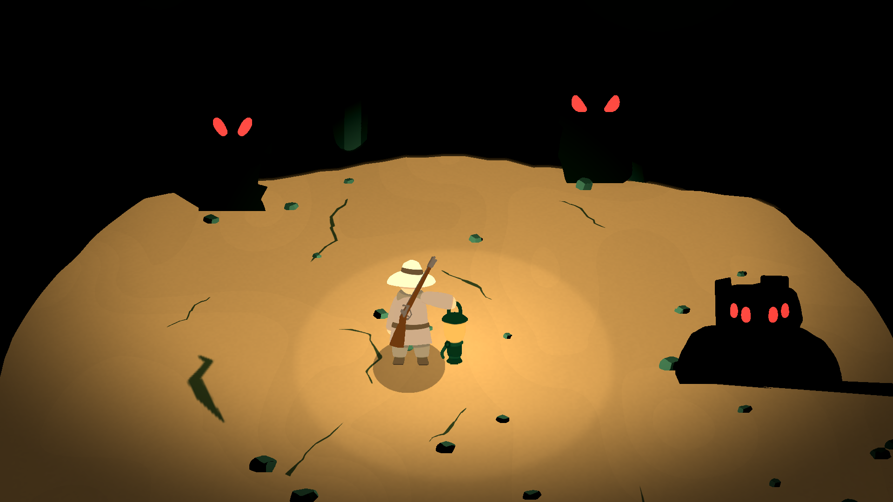
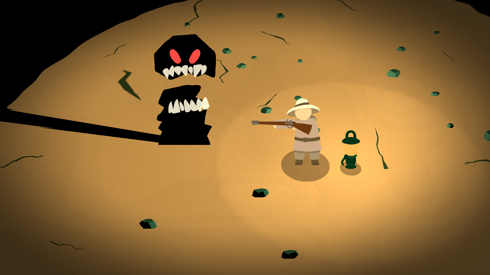

# While the Lantern Burns

A game for the Ludum Dare #60 compo. Explore dark caverns, keep your lantern charged, and prepare your musket for what waits beyond the light.

## Links

- [Play the game on Itch](https://martindzejky.itch.io/while-the-lantern-burns)
- [Rate on Ludum Dare](https://ldjam.com/events/ludum-dare/60/while-the-lantern-burns)

## Screenshots

<table>
  <tr>
    <td width="25%"><a href="screenshots/main-menu.png"></a></td>
    <td width="25%"><a href="screenshots/lantern-discovery-blue.png"></a></td>
    <td width="25%"><a href="screenshots/lantern-winding-passage.png"></a></td>
    <td width="25%"><a href="screenshots/lantern-warm-chamber.png"></a></td>
  </tr>
  <tr>
    <td width="25%"><a href="screenshots/musket-fired-smoke.png"></a></td>
    <td width="25%"><a href="screenshots/monster-watchers.png"></a></td>
    <td width="25%"><a href="screenshots/monster-surrounded.png"></a></td>
    <td width="25%"><a href="screenshots/monster-bite-threat.png"></a></td>
  </tr>
</table>

## Progress

The journey has three caves. Entering a cave saves a checkpoint; Retry restores that cave's entrance, equipment and tutorial progress, with its monsters reset. Continue resumes the checkpoint after closing the game. New Game replaces it, and escaping clears it.

Discovered equipment follows you between caves. Lantern charge, reload progress and remaining fuse time carry over; transitions pause them. A pending trigger pull is cancelled when crossing, leaving the loaded shot available.

Web saves use the browser's storage for the current site. Native saves use Godot's `user://` directory.

To check checkpoints, level geometry and camera facing:

```sh
godot --headless --script res://tests/checkpoints.gd
godot --headless --script res://tests/levels.gd
godot --headless --script res://tests/camera_facing.gd
```

## Theme

> "Old tech"

## Goal

My main goal was to make something tiny and original that doubles as a technical and artistic playground for my bigger project [Whisperlands](https://www.youtube.com/@martindzejky). I think I did manage to achieve that here. I experiment with many ideas and techniques that I wanted to try for a long time, and I learned a ton of new things with Godot.

## Experiments

These are what I wanted to try out:

- 2D sprites in 3D world - Inspired by games like Cult of the Lamb and Don't Starve. Until now, I've only ever made fully 2D games. This was a completely new experience to me, and it was difficult. I have many open questions after this project.
- 2D skeletal animation - Never tried that yet in Godot. Previously I used simple 2D sprites, animations were procedural and used a few sprite frames.
- Generated audio effects - This is just something I wanted to experiment with out of curiosity. For basically all audio effects in the game, I used audio samples from [ElevenLabs](https://elevenlabs.io). Some of them come from their existing library, some I generated myself. Most of them I then hand-tuned: cropped, sliced, layered, adjusted.

## Tech

- Godot - My trusty game engine I love.
- Procreate - Drawing 2D art for the game.
- Notion - Writing notes, planning.
- VS Code - My code editor of choice.
- Codex - Coding agent writing the code (I make the choices).
- ElevenLabs - Used their audio samples for sound effects and ambience in the game.
- Ableton - Editing and layering sounds.
- LosslessCut - Quick cropping of audio samples.
