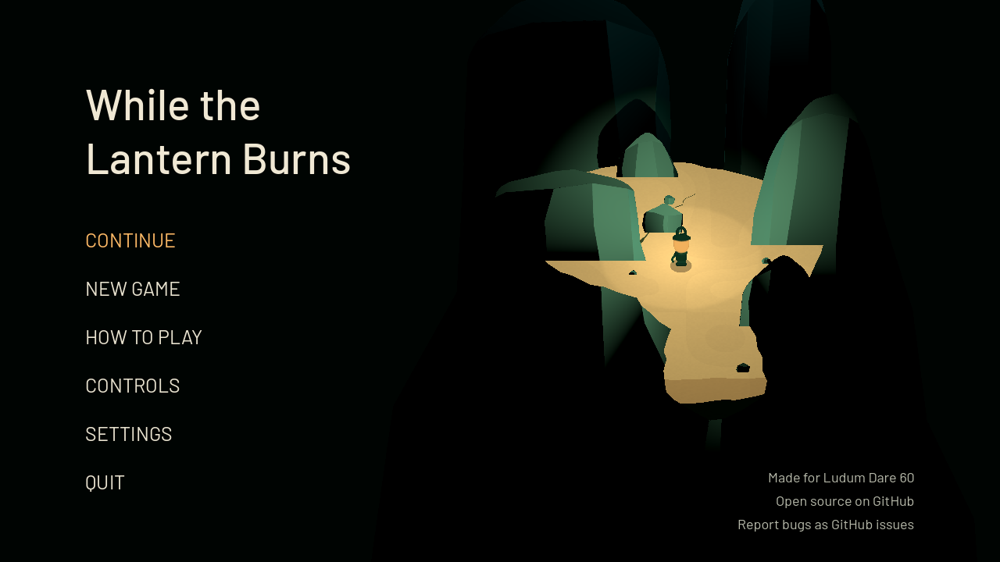
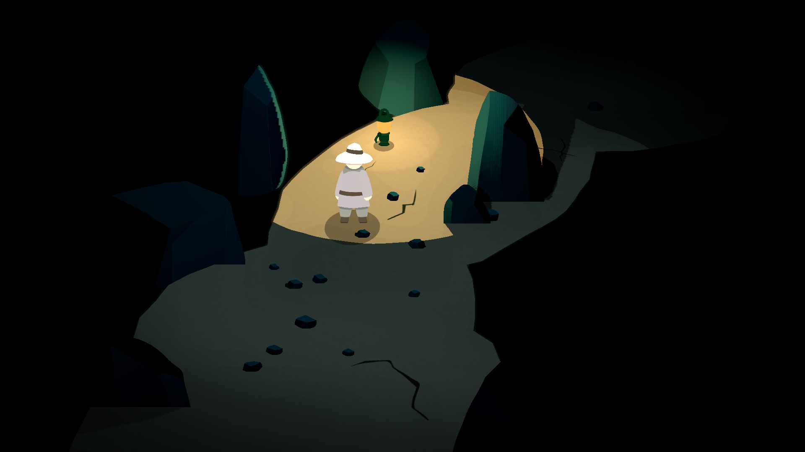
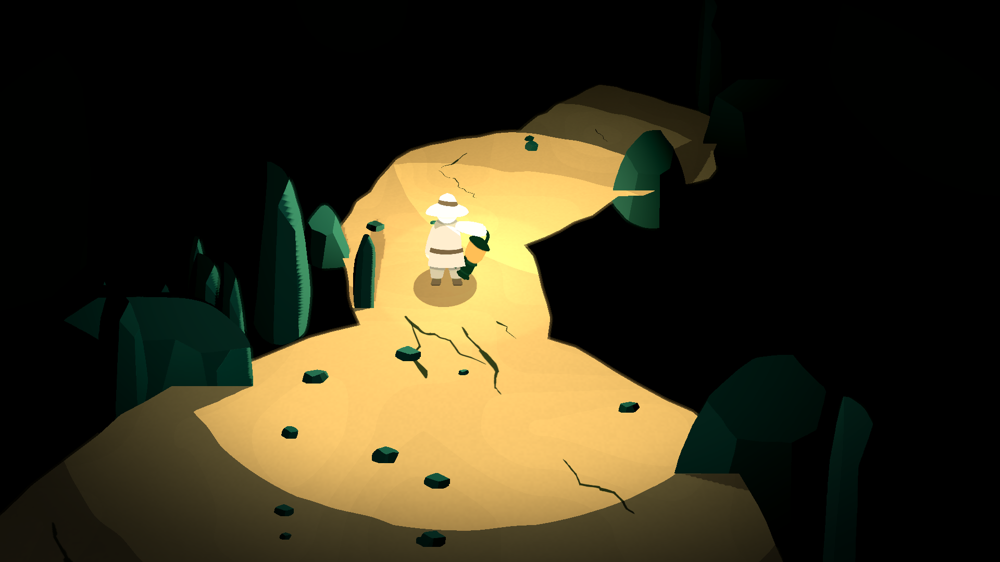
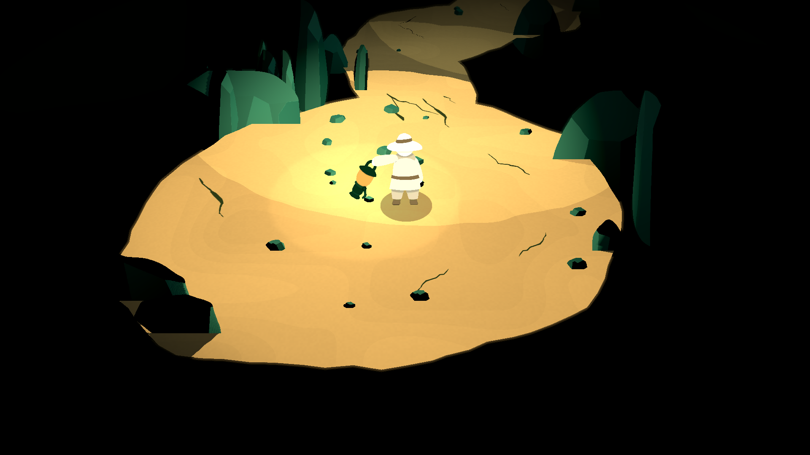
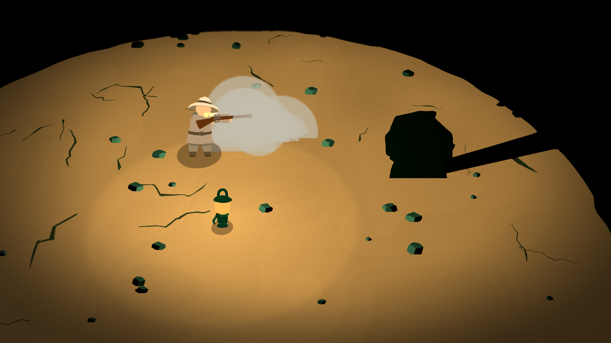
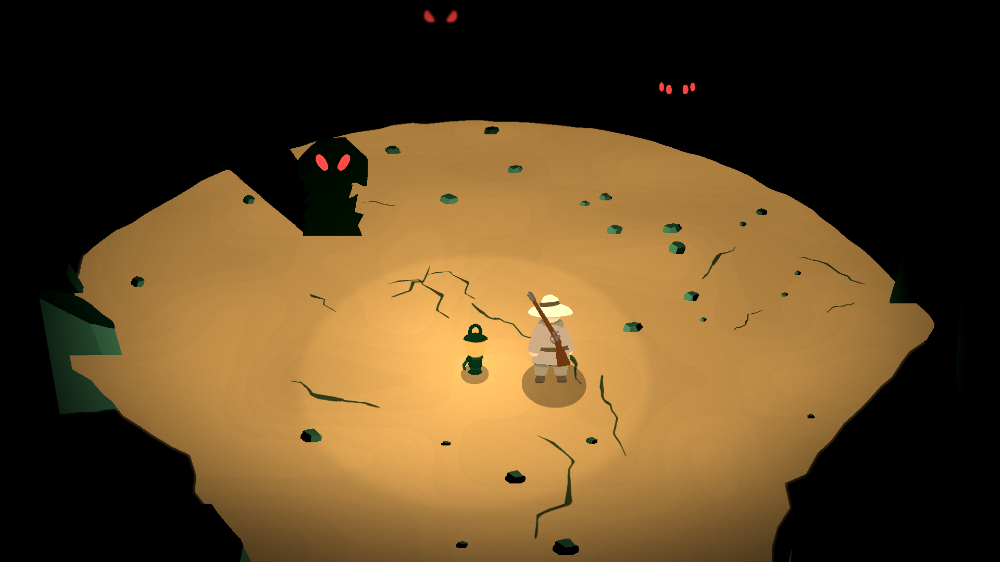
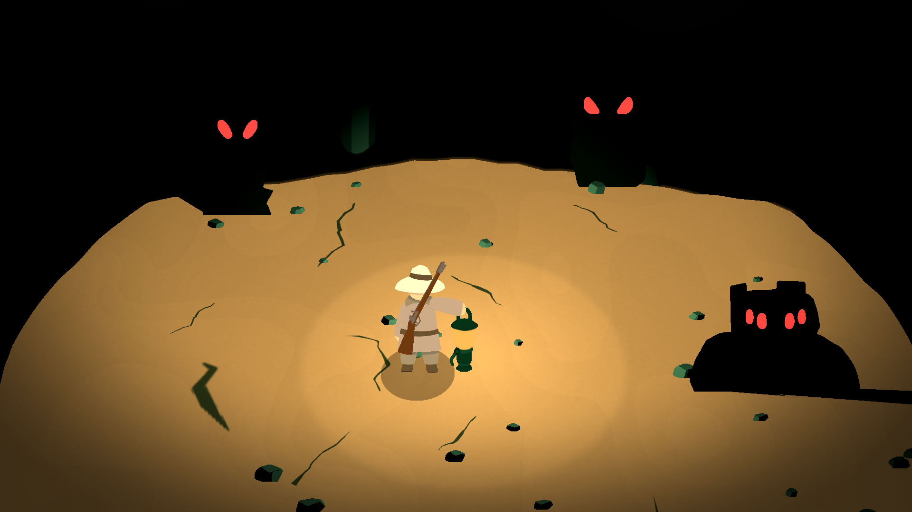
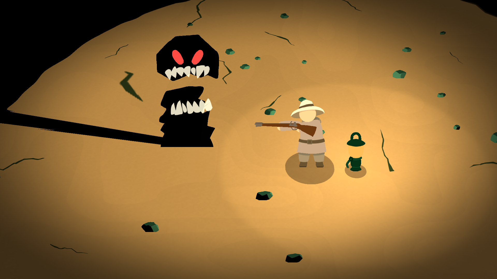

# While the Lantern Burns

A game for the Ludum Dare #60 compo. Explore dark caverns, keep your lantern charged, and prepare your musket for what waits beyond the light.

Development is complete. This repository preserves the game and its source, including updates made after the jam.

## Links

- [Play the game on Itch](https://martindzejky.itch.io/while-the-lantern-burns)
- [Ludum Dare submission](https://ldjam.com/events/ludum-dare/60/while-the-lantern-burns)
- [Illustrated how-to-play guide](https://martindzejky.itch.io/while-the-lantern-burns/devlog/1716534/how-to-play-the-game)

## Screenshots

<table>
  <tr>
    <td width="25%"></td>
    <td width="25%"></td>
    <td width="25%"></td>
    <td width="25%"></td>
  </tr>
  <tr>
    <td width="25%"></td>
    <td width="25%"></td>
    <td width="25%"></td>
    <td width="25%"></td>
  </tr>
</table>

## How to play

Play in a desktop browser with a keyboard and mouse. The main menu includes an illustrated **How to Play** guide and a **Controls** screen.

| Input | Action |
| --- | --- |
| WASD / Arrow keys | Move |
| E / Enter | Pick up an item or put down the lantern |
| Left click on the lantern handle | Pump the lantern |
| Left click on the musket barrel opening | Insert a ball |
| Left click + drag the ramrod down | Load the musket |
| R / Shift / Space beside a charged, grounded lantern | Light the loaded musket's fuse |
| Hold right mouse + move the mouse | Aim |
| Left click while aiming | Fire |
| Escape | Pause |

Put the lantern down to use the musket. Keep the lantern charged, and shoot rocks to clear blocked passages.

## Saving progress

The journey has three caves. Entering a cave saves a checkpoint; Retry restores that cave's entrance, equipment and tutorial progress, with its monsters reset. Continue resumes the checkpoint after closing the game. New Game replaces it, and escaping clears it.

Discovered equipment follows you between caves. Lantern charge, reload progress and remaining fuse time carry over.

Web saves use the browser's storage for the current site. Clearing that storage removes your progress. Native saves use Godot's user data directory.

## Running the source

Open `project.godot` in **Godot 4.7.2** and press **F5** to play the full game. The project uses the Compatibility renderer and needs no additional plugins or dependencies to run.

See [DEVELOPMENT.md](DEVELOPMENT.md) for validation, Web export and release instructions.

## Theme

> "Old tech"

## Goal

My main goal was to make something tiny and original that doubles as a technical and artistic playground for my bigger project [Whisperlands](https://www.youtube.com/@martindzejky). I think I did manage to achieve that here. I experimented with many ideas and techniques that I wanted to try for a long time, and I learned a ton of new things with Godot.

## Experiments

These are what I wanted to try out:

- 2D sprites in 3D world - Inspired by games like Cult of the Lamb and Don't Starve. Until now, I've only ever made fully 2D games. This was a completely new experience to me, and it was difficult. I have many open questions after this project.
- 2D skeletal animation - Never tried that yet in Godot. Previously I used simple 2D sprites, animations were procedural and used a few sprite frames.
- Generated audio effects - This is just something I wanted to experiment with out of curiosity. For basically all audio effects in the game, I used audio samples from [ElevenLabs](https://elevenlabs.io). Some of them come from their existing library, some I generated myself. Most of them I then hand-tuned: cropped, sliced, layered, adjusted.

## Tech

- Godot - My trusty game engine I love.
- Procreate - Drawing 2D art for the game.
- Notion - Writing notes, planning.
- VS Code - My code editor of choice.
- Codex - Coding agent writing the code (I make the choices).
- ElevenLabs - Used their audio samples for sound effects and ambience in the game.
- Ableton - Editing and layering sounds.
- LosslessCut - Quick cropping of audio samples.

## License and credits

Created by Martin Jakubík. The source code is available under the [MIT license](LICENSE).

- The Barlow font is by The Barlow Project Authors, licensed under the [SIL Open Font License 1.1](resources/menu/OFL.txt).
- Sound effects and ambience use samples from ElevenLabs, edited and layered for the game. These third-party samples are subject to their original licensing terms.
- Editable rock artwork is in [art/rocks](art/rocks/README.md), and the Ableton music project is in `music/`.
